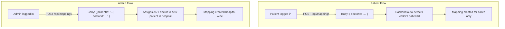
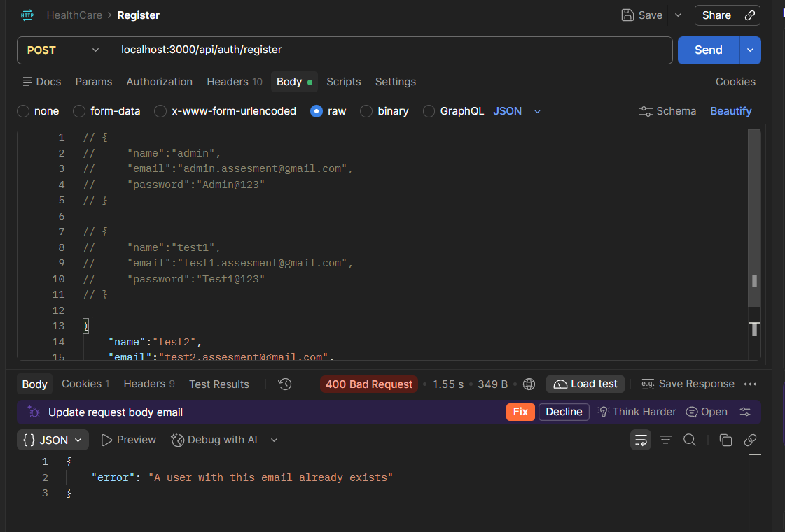
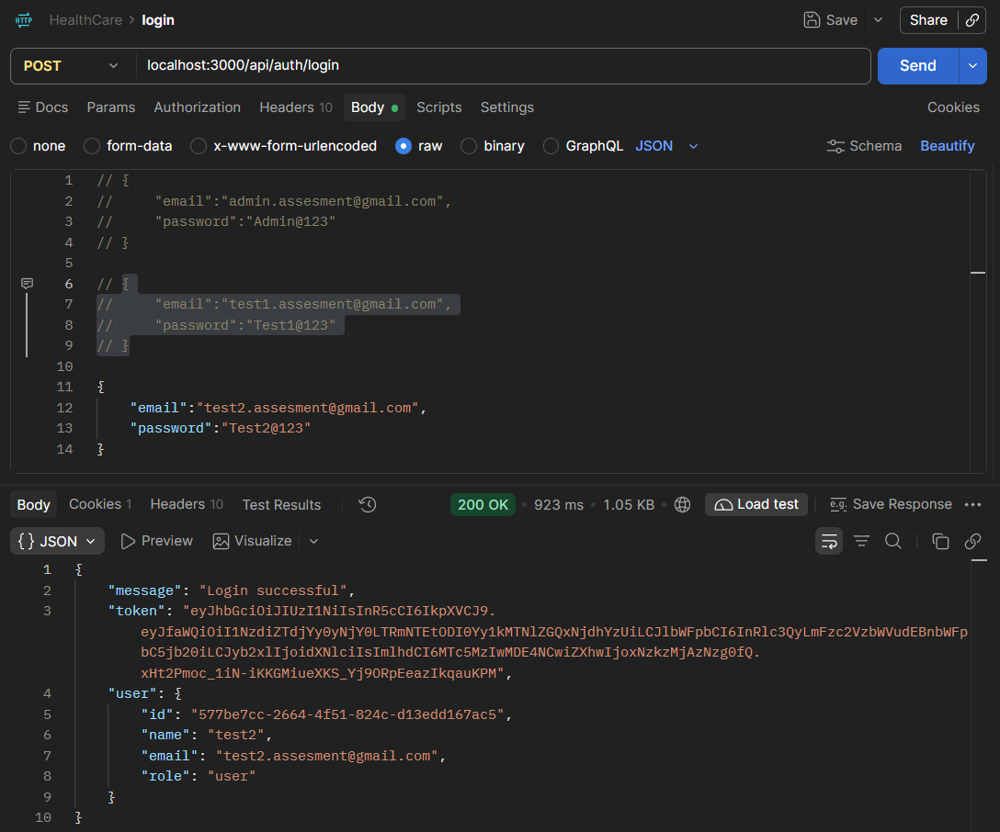
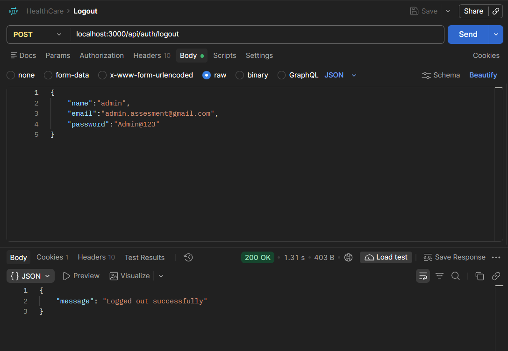

# Healthcare Backend — Architecture, Roles & API Documentation

A secure, high-performance healthcare backend built with **Node.js (Express v5)**, **PostgreSQL (Sequelize ORM)**, and **Redis**. Designed around the **Profile Pattern (Class Table Inheritance)** with JWT authentication stored in HTTP-only cookies, Redis token blacklisting on logout, and database-level relational constraints.

---

## 📑 Table of Contents
1. [Architecture & Schema Design](#1-architecture--schema-design)
2. [Role-Based Access Control (RBAC)](#2-role-based-access-control-rbac)
3. [Patient-Doctor Mapping Workflows (Patient vs. Admin)](#3-patient-doctor-mapping-workflows-patient-vs-admin)
4. [Endpoint Specifications](#4-endpoint-specifications)
   * [Authentication APIs](#1-authentication-apis-apiauth)
   * [Patient Management APIs](#2-patient-management-apis-apipatients)
   * [Doctor Management APIs](#3-doctor-management-apis-apidoctors)
   * [Patient-Doctor Mapping APIs](#4-patient-doctor-mapping-apis-apimappings)
5. [Master Permissions & Endpoint Matrix](#5-master-permissions--endpoint-matrix)
6. [Postman Testing & API Verification](#6-postman-testing--api-verification)
   * [Postman Collection Import](#postman-collection-import)
   * [Authentication Screenshots](#authentication-screenshots)
   * [Patient Management Screenshots](#patient-management-screenshots)
   * [Doctor Management Screenshots](#doctor-management-screenshots)
   * [Patient-Doctor Mapping Screenshots](#patient-doctor-mapping-screenshots)

---

## 1. Architecture & Schema Design

Rather than packing all attributes into a wide, sparse table or using brittle role mutations, the database uses **Class Table Inheritance (Profile Pattern)**:

```
                      ┌────────────────────────────────────────┐
                      │              users table               │
                      │  (id, name, email, password, role)     │
                      │         role: 'user' | 'admin'         │
                      └───────────────────┬────────────────────┘
                                          │
                  ┌───────────────────────┴────────────────────────┐
                  ▼ (1:0..1 optional)                              ▼ (1:0..1 optional)
        ┌──────────────────┐                             ┌──────────────────┐
        │  patients table  │                             │  doctors table   │
        │  (age, gender,   │                             │ (specialization, │
        │  medicalHistory) │                             │ availableDays)   │
        └─────────┬────────┘                             └─────────┬────────┘
                  │                                                │
                  └──────────────► patient_doctor_mappings ◄───────┘
                                   (patientId, doctorId,
                                    assignedById, notes)
```

### Core Architecture Principles:
1. **Single Source of Truth**: User name and login email are stored exclusively in the `users` table.
2. **Support for Walk-Ins & Unlinked Entries**: An emergency patient or visiting doctor without a login account can be stored with `userId: null` and a `displayName`.
3. **Zero Role Collisions**: An account can have a doctor profile, a patient profile, or both without ENUM conflicts.
4. **Relational Integrity**: `patient_doctor_mappings` directly references `patients(id)` and `doctors(id)` with a composite unique constraint on `(patient_id, doctor_id)` preventing duplicate assignments at the database engine level.

---

## 2. Role-Based Access Control (RBAC)

The system distinguishes between **Administrative Roles** (`users.role`) and **Clinical Profiles** (`patients`, `doctors`):

| Role / Entity | Scope | Permissions |
|---|---|---|
| **`user`** (Standard) | Default account | Discover doctors, create personal patient profile, onboarding. |
| **`patient`** (Profile) | Linked to user | Manage personal health profile, self-assign doctors, view assigned doctors. |
| **`doctor`** (Profile) | Linked to user | Manage medical practice schedule, view assigned patient charts, discharge patients. |
| **`admin`** (Privilege) | Hospital Supervisor | Full CRUD across users, patients, doctors, and assignments. |

### 🔒 Privacy Guarantees by Role:
* **Patients CANNOT view other patients**: When a patient calls `GET /api/patients`, the database query applies `where: { userId: req.user.id }` and returns **only their own chart**. Calling `GET /api/patients/<other-id>` returns `403 Forbidden`.
* **Doctors only see their assigned patients**: When a doctor calls `GET /api/patients`, the query filters to patients mapped to them via `patient_doctor_mappings`.
* **Admins see hospital-wide data**: Only admins receive unconstrained records across the entire facility.

---

## 3. Patient-Doctor Mapping Workflows (Patient vs. Admin)

Both **Patients** and **Admins** have authority to create doctor assignments, but with different authorization scopes:



### 1. Patient Self-Mapping:
* **Who:** Any authenticated user with a patient profile.
* **Request Body:** Requires **only** `doctorId`:
  ```json
  {
    "doctorId": "c5a324f6-37f0-4360-b92a-eb759c97b7dc",
    "notes": "Routine cardiovascular consultation"
  }
  ```
* **Behavior:** The backend automatically identifies the caller via their JWT session and resolves their own `patientId`.
* **Security:** If a patient attempts to pass another patient's ID, the server blocks the request with `403 Forbidden: you can only assign doctors to your own patient profile`.

### 2. Admin Hospital Mapping:
* **Who:** Hospital Administrator (`role === 'admin'`).
* **Request Body:** Requires **both** `patientId` and `doctorId`:
  ```json
  {
    "patientId": "692fc6f5-9ea6-496f-91d0-62709121c468",
    "doctorId": "c5a324f6-37f0-4360-b92a-eb759c97b7dc",
    "notes": "Post-operative follow up scheduled by admin"
  }
  ```
* **Behavior:** The admin can link any doctor to any patient across the entire hospital database.

---

## 4. Endpoint Specifications

### 1. Authentication APIs (`/api/auth`)

| Endpoint | Method | Access | Description |
|---|:---:|:---:|---|
| `/api/auth/register` | `POST` | Public | Register standard account (`name`, `email`, `password`) |
| `/api/auth/login` | `POST` | Public | Log in and receive secure HTTP-only cookie session |
| `/api/auth/logout` | `POST` | Protected | Invalidate JWT immediately in Redis blacklist |
| `/api/auth/check` | `GET` | Protected | Validate active session |
| `/api/auth/admin/register` | `POST` | Self-bootstraps / Admin | Create admin (open if 0 admins exist; otherwise requires admin token) |
| `/api/auth/users` | `GET` | Admin only | List all registered users |
| `/api/auth/users/:id/role` | `PUT` | Admin only | Promote / update account role (`'user'` or `'admin'`) |

---

### 2. Patient Management APIs (`/api/patients`)

| Endpoint | Method | Access | Description |
|---|:---:|:---:|---|
| `/api/patients` | `POST` | Protected | Create patient profile (name pulled from user; optional `displayName` for walk-ins) |
| `/api/patients` | `GET` | Protected | Retrieve patients (Admin: all, Doctor: assigned, Patient: own record) |
| `/api/patients/me` | `GET` | Protected | Get logged-in user's patient profile |
| `/api/patients/me` | `PUT` | Protected | Update logged-in user's patient profile |
| `/api/patients/me` | `DELETE` | Protected | Delete personal patient profile |
| `/api/patients/:id` | `GET` | Protected | Get specific patient details (Admin, Owner, or Assigned Doctor) |
| `/api/patients/:id` | `PUT` | Protected | Update patient record (Admin or Owner) |
| `/api/patients/:id` | `DELETE` | Protected | Delete patient record (Admin or Owner) |

---

### 3. Doctor Management APIs (`/api/doctors`)

| Endpoint | Method | Access | Description |
|---|:---:|:---:|---|
| `/api/doctors` | `GET` | Public | List all doctors (supports `?page=1&limit=20`) |
| `/api/doctors/:id` | `GET` | Public | Get single doctor details by ID |
| `/api/doctors/me` | `GET` | Protected | Get logged-in doctor's profile |
| `/api/doctors/me` | `PUT` | Protected | Update logged-in doctor's profile |
| `/api/doctors` | `POST` | Protected | Add new doctor profile (Admin or practitioner onboarding) |
| `/api/doctors/:id` | `PUT` | Protected | Update doctor record (Admin or profile owner) |
| `/api/doctors/:id` | `DELETE` | Protected | Delete doctor record (Admin or profile owner) |

---

### 4. Patient-Doctor Mapping APIs (`/api/mappings`)

| Endpoint | Method | Access | Description |
|---|:---:|:---:|---|
| `/api/mappings` | `POST` | Protected | Assign doctor to patient (Patient self-assigns or Admin specifies both IDs) |
| `/api/mappings` | `GET` | Protected | List mappings (Admin: all, Patient: own doctors, Doctor: assigned patients) |
| `/api/mappings/:patientId` | `GET` | Protected | Get all doctors assigned to a specific patient |
| `/api/mappings/:id` | `DELETE` | Protected | Remove doctor assignment (Admin, Patient owner, or Assigned Doctor) |

---

## 5. Master Permissions & Endpoint Matrix

| Method | Endpoint | Public | Standard User | Linked Patient | Linked Doctor | Admin |
|:---:|---|:---:|:---:|:---:|:---:|:---:|
| **POST** | `/api/auth/register` | ✅ | - | - | - | - |
| **POST** | `/api/auth/login` | ✅ | ✅ | ✅ | ✅ | ✅ |
| **POST** | `/api/auth/logout` | ❌ | ✅ | ✅ | ✅ | ✅ |
| **GET** | `/api/auth/check` | ❌ | ✅ | ✅ | ✅ | ✅ |
| **POST** | `/api/auth/admin/register` | 1st time only | ❌ | ❌ | ❌ | ✅ |
| **GET** | `/api/auth/users` | ❌ | ❌ | ❌ | ❌ | ✅ |
| **PUT** | `/api/auth/users/:id/role` | ❌ | ❌ | ❌ | ❌ | ✅ |
| **GET** | `/api/doctors` | ✅ | ✅ | ✅ | ✅ | ✅ |
| **GET** | `/api/doctors/:id` | ✅ | ✅ | ✅ | ✅ | ✅ |
| **GET** | `/api/doctors/me` | ❌ | ❌ | ❌ | ✅ | ❌ |
| **PUT** | `/api/doctors/me` | ❌ | ❌ | ❌ | ✅ | ❌ |
| **POST** | `/api/doctors` | ❌ | Self-link | Self-link | ❌ | **All** |
| **PUT** | `/api/doctors/:id` | ❌ | ❌ | ❌ | Own | **All** |
| **DELETE** | `/api/doctors/:id` | ❌ | ❌ | ❌ | Own | **All** |
| **POST** | `/api/patients` | ❌ | Self-link | ❌ | Self-link | **All** |
| **GET** | `/api/patients` | ❌ | Own | Own | Assigned | **All** |
| **GET** | `/api/patients/me` | ❌ | ❌ | ✅ | ❌ | ❌ |
| **PUT** | `/api/patients/me` | ❌ | ❌ | ✅ | ❌ | ❌ |
| **DELETE** | `/api/patients/me` | ❌ | ❌ | ✅ | ❌ | ❌ |
| **GET** | `/api/patients/:id` | ❌ | Own | Own | Assigned | **All** |
| **PUT** | `/api/patients/:id` | ❌ | Own | Own | ❌ | **All** |
| **DELETE** | `/api/patients/:id` | ❌ | Own | Own | ❌ | **All** |
| **POST** | `/api/mappings` | ❌ | ❌ | Own | ❌ | **All** |
| **GET** | `/api/mappings` | ❌ | ❌ | Own | Assigned | **All** |
| **GET** | `/api/mappings/:patientId` | ❌ | ❌ | Own | Assigned | **All** |
| **DELETE** | `/api/mappings/:id` | ❌ | ❌ | Own | Assigned | **All** |

---

## 6. Postman Testing & API Verification

A complete Postman test suite has been maintained for end-to-end verification across all routes.

### Postman Collection Import
The collection file is located at:
📁 [`postman_testing/Healthcare_API.postman_collection.json`](./postman_testing/Healthcare_API.postman_collection.json)

To import into Postman:
1. Open Postman → click **Import**.
2. Select `Healthcare_API.postman_collection.json`.
3. Set your collection variable `baseUrl` to `http://localhost:3000`.

---

### Authentication Screenshots

#### 1. User Registration (`POST /api/auth/register`)


#### 2. User Login (`POST /api/auth/login`)


#### 3. User Logout (`POST /api/auth/logout`)


---

### Patient Management Screenshots

#### 1. Add a New Patient (`POST /api/patients`)


#### 2. Get All Patients — Filtered to Own Record (`GET /api/patients`)


#### 3. Get Patient by ID (`GET /api/patients/:id`)


#### 4. Update Patient Details (`PUT /api/patients/:id`)


#### 5. Delete Patient Record (`DELETE /api/patients/:id`)


---

### Doctor Management Screenshots

#### 1. Add a New Doctor (`POST /api/doctors`)
.png>)

#### 2. Get All Doctors (`GET /api/doctors`)


#### 3. Get Doctor by ID (`GET /api/doctors/:id`)


#### 4. Update Doctor Details (`PUT /api/doctors/:id`)


#### 5. Delete Doctor Record (`DELETE /api/doctors/:id`)


---

### Patient-Doctor Mapping Screenshots

#### 1. Mapping Patient with Doctor (`POST /api/mappings`)


#### 2. Get All Mappings — Role Filtered (`GET /api/mappings`)


#### 3. Get All Doctors Assigned to a Specific Patient (`GET /api/mappings/:patientId`)


#### 4. Delete Mapping (`DELETE /api/mappings/:id`)

